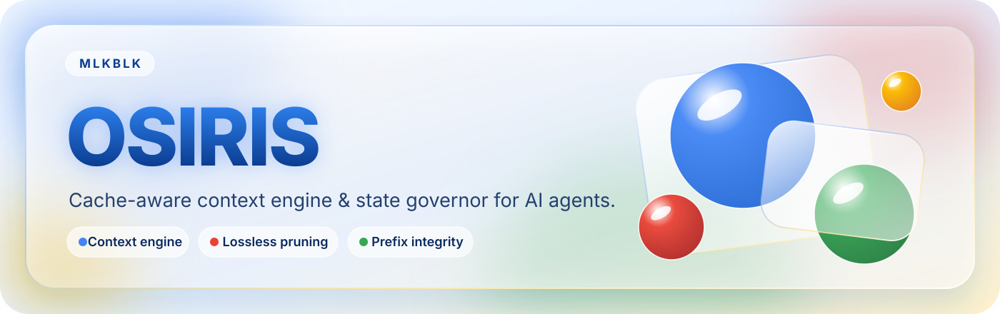

<p align="center">
  
</p>

# OSIRIS

**Context engine cache-aware pour agents IA.** Serveur MCP standard, local-first,
indépendant de tout provider.

> OSIRIS rend un agent moins cher, plus rapide et plus fiable : moins de tokens,
> moins de boucles, moins d'outils inutiles, moins de pertes de contexte.

OSIRIS ne remplace pas les autres MCP (filesystem, Git, GitHub, shell, browser…).
Il les **cohabite** et réduit ce qu'ils coûtent en contexte.

---

## 1. La contrainte qui définit toute l'architecture

Un serveur MCP ne **voit jamais** le prompt assemblé par le client. Il ne voit
que ce que l'agent lui envoie. Donc OSIRIS ne peut pas :

| Ce qu'on voudrait | Ce qu'un serveur MCP standard peut faire |
|---|---|
| écrire dans le prompt | produire un contenu canonique et **le faire porter** par l'agent |
| supprimer un message passé | décider quoi externaliser **pour la suite** |
| masquer les tools d'un autre serveur | **recommander** (Tool Compass) |
| plafonner des tokens | bloquer une **action** (invariants, budget) |

La promesse est donc formulée honnêtement : OSIRIS fournit **un contenu stable
et un contrat de sécurité**, pas un constructeur de prompt.

---

## 2. Le manifeste scellé — le cœur du design

`osiris.plan` renvoie un bloc déterministe (~120 tokens) que l'agent insère à
position fixe dans son contexte :

```text
OSIRIS/1 task=7c3f obj="corriger le bug profil PS" plan=3/7
inv=4 files=6 refs=9 dec=2 budget=ok
SEAL=sha256:3f9a1c…c21b
```

Le `SEAL` est le hash des zones stables. L'agent le renvoie à chaque tour dans
`osiris.observe` : OSIRIS recalcule et détecte toute dérive.

**C'est le support passif d'OSIRIS** : même si l'agent n'appelle plus aucun
outil, il transporte déjà l'essentiel de l'état utile.

### Trois hashes, parce que le cache est un préfixe

```
head_hash   = sha256(system_head ‖ règles)                     immuable
zoneB_hash  = sha256(objectif ‖ plan_global ‖ tool_contract)  quasi-stable
tail_hash   = sha256(constraintes ‖ décisions épinglées)       append-only
prefix_hash = sha256(head_hash ‖ zoneB_hash)                  ← ce qui est caché
zoneA_hash  = sha256(head_hash ‖ tail_hash)                   ← ZONE A complète
```

| Changement | Verdict | Coût cache |
|---|---|---|
| `head_hash` | **DRIFT CRITIQUE** | re-prefill total |
| `zoneB_hash` | drift mineur | re-prefill du delta |
| `tail_hash` (ajout) | **croissance normale** | re-prefill du delta seul |
| élément épinglé **réécrit** | **DRIFT CRITIQUE (sémantique)** | cache intact, état changé |

> **Ajouter** une contrainte ou une décision change `tail_hash` mais **pas**
> `prefix_hash` : le cache tient, seul le delta est re-prefill.
>
> **Réécrire** un élément épinglé est détecté explicitement : OSIRIS compare les
> collections elles-mêmes (pas seulement leurs hashes) et signale une rupture
> **sémantique** — le préfixe cache est intact, mais l'état de la tâche a changé
> de sens (`semantic_break: true`, `cause: pinned_rewrite`).
>
> Les contraintes vivent dans la **queue append-only**, pas dans le head :
> en hinzuge qu'une contrainte — geste courant — déclenchait un drift critique
> alors que le cache était intact. Le signal de dérive doit être rare pour
> qu'il reste crédible.

---

## 3. Les 6 outils

Footprint mesuré : **1 019 tokens** de schemas + descriptions dans le contexte
du modèle à chaque requête (mesuré par `bench/run_bench.py`). C'est le **coût
d'accès** d'OSIRIS : payé en continu, il s'amortit sur les tâches de la session
— 1 tâche dès 800 tokens de payload, 2 tâches à 800 tokens. C'est 10× moins que
les 40 tools d'un agent classique.

| Outil | Rôle | Réponse typique |
|---|---|---|
| `osiris.plan` | démarre / met à jour / reprend / **statut** une tâche, produit le manifeste | ~160 tok |
| `osiris.precheck` | autorise ou refuse une action (invariants, budget, doublon) | ~70 tok |
| `osiris.observe` | consigne, détecte les boucles, externalise, met à jour la mémoire | ~50 tok |
| `osiris.recall` | réhydrate un ref (extrait ciblé, **filtré côté serveur**) ou restitue l'état | variable |
| `osiris.checkpoint` | snapshot, reprise, rapport final, **compaction** (compact/trim/clear) | ~80 tok |
| `osiris.handoff` | contrat de délégation / résultat structuré | ~200 tok |

`osiris.observe` porte cinq responsabilités (journal + anti-boucle + externalisation
+ mémoire + seal + prune auto) : l'agent n'a **qu'un seul endroit** où rapporter,
donc le taux de coopération est maximal. `osiris.recall` fait de l'extrait ciblé
avec budget de tokens : sans ça, l'externalisation ne rapporterait rien.

### Modes ajoutés (2026-10-31)

| Appel | Effet |
|---|---|
| `osiris.observe(kind="dropped", result=<ref>)` | **accusé de réception** : l'agent confirme avoir retiré le payload de son contexte → l'économie est enfin **prouvée** et créditée |
| `osiris.observe(kind="head"\|"contract", result=…)` | enregistre le system head / le contrat d'outils du client et **détecte le contenu volatil** (timestamps, UUID, build id) qui tue le cache |
| `osiris.recall(op="grep"\|"range"\|"head"\|"tail"\|"outline"\|"aggregate"\|"jsonl")` | **filtrage côté serveur** : seul le résultat entre dans le contexte (le pattern « code execution with MCP ») |
| `osiris.plan(mode="status")` | décomposition de la pression contexte (mesurée / déclarée / inconnue) |
| `osiris.checkpoint(mode="compact"\|"trim"\|"clear")` | préparation de la compaction : résumé déterministe, allègement de la zone de travail |
| `osiris.precheck` → `suggest_alternative` | le verdict **existe** : il était du code mort (le doublon passait en `warn`) |

### Resources et prompts MCP

En plus des 6 outils, OSIRIS expose des **resources** (lecture directe, sans
aller-retour d'outil) et un **prompt** :

- `osiris://task/{task_id}/manifest` — zones, drift, objectif
- `osiris://task/{task_id}/status` — pression contexte
- `osiris://ref/{ref}` — contenu brut d'un ref
- prompt `osiris/task-resume` — modèle de reprise après crash

### Un seul schéma (opt-in)

Le tableau `tools` du client fait partie du préfixe mis en cache : le modifier
invalide le cache. `OSIRIS_DISPATCH_ONLY=1` n'expose alors qu'un point
d'entrée unique, `osiris.call(op, args)`, dont le tableau reste stable dans le
temps. Par défaut, les 6 outils sont exposés (leur tableau ne change jamais).

---

## 4. Architecture

```
┌──────────────────────────────────────────────────────────────┐
│  Agent (Claude Code, Cursor, MiniMax Code, Codex, Cline…)   │
│  contexte : system │ tools │ CONTEXTE OSIRIS │ historique    │
└───────────────────────────┬──────────────────────────────────┘
                            │  MCP stdio — 6 outils, ~900 tok
                            ▼
┌──────────────────────────────────────────────────────────────┐
│  osiris-mcp  (server.py)                                     │
│  plan · precheck · observe · recall · checkpoint · handoff   │
└───────────────────────────┬──────────────────────────────────┘
                            │
┌───────────────────────────▼──────────────────────────────────┐
│  core/                                                        │
│   task_state  TaskState typé (objectif, plan, décisions…)   │
│   memory     registre typé par kind et scope                 │
│   refs       store content-addressed, vérifié à la lecture  │
│   prefix     zones, 3 hashes, drift, PrefillPlan             │
│   prune      externalisation réversible, 4 modes             │
│   query      filtrage serveur des payloads (grep, range…)    │
│   compaction trim / compact / clear (réversibles)            │
│   pressure   décomposition de la pression contexte            │
│   loopguard  fingerprint, 5 détections                       │
│   invariants moteur de règles anti-casse (TOML)              │
│   compass    Tool Compass (3-5 outils pertinents)            │
│   handoff    contrats de délégation exécutables               │
│   events     journal append-only + checkpoints                │
│   ledger     tokens / coût / économies / surcoût OSIRIS      │
│   fileops    lecture sandboxée (racines, taille, secrets)     │
│   redact     secrets masqués AVANT le hash                   │
│   policy     budget (défauts + override utilisateur)         │
└───────────────────────────┬──────────────────────────────────┘
                            ▼
        ~/.osiris/osiris.db  +  ~/.osiris/reports/
```

---

## 5. Mémoire

Mémoire **typée, déterministe, adressable** — pas un moteur vectoriel.

```
TaskState
├── objective      immuable
├── constraints[]  append-only
├── decisions[]    append-only, épinglées verbatim
├── plan           étapes faites / courante / restantes
├── files{}        chemin, hash, mtime, dernier accès, ref
├── tool_results{} cache_key, ref, taille, coût, TTL
├── failures{}     signature d'erreur, tool, args hash, essais, leçon
├── lessons[]      règles générales apprises
├── handoffs{}     contrats entre agents
└── budget         tokens / coût estimés / consommés
```

Quatre scopes : `task`, `project`, `agent`, `global`. La promotion
automatique s'arrête à `project` — `global` n'est jamais écrit sans action
explicite.

---

## 6. Pruning cache-aware

**Invariant de sécurité : le prune déplace un payload vers un ref. Il ne le
supprime jamais.** Il n'existe aucun chemin de code qui supprime.

```
coût_pruning_ZONE_A = tokens_prunés
coût_pruning_ZONE_C/D = 0                       ← toujours gratuit
gain_total = tokens_prunés − (tokens_préfixe × P(cache_mort) × si_prune_du_préfixe)
```

Le TTL du cache provider est un **paramètre** de l'utilisateur, pas une
dépendance. `P(cache_mort)` est un **seuil**, pas une rampe : le TTL est
déterministe, donc `P(mort) = 0` avant le TTL et `1` après.

> Correction du 2026-10-31 : la probabilité était calculée en `Δt / TTL`, une
> rampe linéaire. Elle inventait une mortalité de 50 % à mi-TTL et autorisait le
> prune du préfixe à 0,9×TTL — donc la destruction d'un cache **encore chaud**.
> De plus, `elapsed_since_last_turn_s` était passé en dur à `0.0` : le prune du
> préfixe ne pouvait **jamais** se déclencher.

Le prune ne s'applique qu'à la **zone de travail** (C/D) tant que le cache est
vivant : toucher au préfixe coûterait un re-prefill. Le gain est donc
`tokens_prunés` quand le cache est mort, et `tokens_prunés − tokens_préfixe ×
P(cache_mort)` seulement si le prune touche effectivement le préfixe.

| Mode | Quand il prune | Retire | Cache | Usage |
|---|---|---|---|---|
| `cache_ttl` | seulement si `Δt > TTL` | C/D, et A/B si le cache est mort | **neutre** | **défaut** |
| `conservative` | seuil très haut | C/D uniquement | nul | provider cher |
| `balanced` | seuil moyen | C/D + tours froids | nul | usage courant |
| `aggressive` | seuil bas | tout ce qui est réhydratable | re-prefill possible | modèle local gratuit |

`cache_ttl` est le seul mode où le pruning du préfixe est **sans risque** : le
cache est déjà mort, donc le re-prefill n'est pas un coût supplémentaire.

---

## 7. Anti-boucle

```
fingerprint = sha256(tool ‖ canonical_args ‖ result_signature)
```

L'agent ne calcule **jamais** de hash : il transmet les arguments bruts, OSIRIS
canonicalise et digeste.

| Détection | Signal | Verdict |
|---|---|---|
| doublon exact | même fingerprint | `suggest_alternative` |
| échec répété | même signature d'erreur (≥3) | `block` + `required_action` |
| pattern de boucle | même erreur, args variables | `warn` |
| oscillation | A/B/A/B sans progression | `warn` |
| runaway | N appels sans mutation utile | `warn` / `block` |

Le doublon de **fichier** est le seul cas où la preuve est objective (hash
identique) : il est traité en `suggest_alternative` fort, jamais en `block`.

---

## 8. Invariants (anti-casse)

`.osiris/invariants.toml` (projet) + `~/.osiris/invariants.toml` (global) :

```toml
[[invariant]]
id = "tests-before-commit"
when   = { tool = "git.commit" }
require = { state = "tests_passed" }
message = "ne pas committer si les tests échouent"

[[invariant]]
id = "no-test-edit"
when   = { path_glob = "tests/**" }
verdict = "block"
message = "ne pas modifier les tests sans approbation"
```

`osiris.precheck` répond alors :

```json
{"verdict":"block","reason":"invariant_violation",
 "invariant":"tests-before-commit","required_action":"set_tests_passed"}
```

> **Limite assumée** : un invariant n'est que aussi bon que le *reporting* de
> l'agent. `tests_passed` n'existe que si l'agent a rapporté le résultat via
> `osiris.observe`.

---

## 9. Recovery

Journal append-only : chaque action produit `begin` puis `result`.

| État | Reprise |
|---|---|
| `succeeded` | **skip** |
| `failed` | retry autorisé |
| `unknown` (begin sans result) | **vérifier**, ne jamais rejouer à l'aveugle |

`run_key = sha256(tool ‖ canonical_args ‖ state_version)` → c'est ce qui
empêche de rejouer une action destructive déjà réussie.

---

## 10. Preuve de non-perte

Contrainte de la spec : *« être capable de prouver qu'aucune information n'a
été perdue »*. Trois mécanismes :

1. **Refs auto-vérifiantes** — `mem://sha256:<hash>`. La lecture recalcule le
   hash avant de renvoyer ; divergence → `integrity_error`, jamais de contenu
   silencieux.
2. **Aucun chemin de suppression** — le prune déplace, il ne supprime pas.
3. **Audit rejouable** — `python -m osiris audit --task <id>` recalcule tout
   depuis le journal et produit :

```json
{"lossless": true, "items_externalized": 14, "items_verified": 14,
 "items_missing": 0, "items_dropped": 0, "integrity_violations": []}
```

Le rapport final affiche `information perdue : 0` — une valeur **calculée**,
pas une promesse.

---

## 11. Métriques

| Catégorie | Métriques |
|---|---|
| **exactes** (journal, sans modèle) | tool calls évités, boucles bloquées, fichiers relus évités, payloads externalisés, reprises, intégrité, prefix stability |
| **estimées** (compteur + table de prix fournie par l'utilisateur) | tokens observés, tokens économisés, coût estimé, cache hit estimate |
| **vérifiables** (vérité externe requise) | coût réel, cache hit réel, régression de qualité, faux blocages |

**Surchcoût propre d'OSIRIS mesuré** : chaque réponse d'outil est comptabilisée
dans le ledger (kind `overhead`), et le coût des schemas celui du client (kind
`schema_access`, une fois par tâche). Le rapport affiche le **gain net**
(économies − surcoût OSIRIS). Si le net est négatif, `osiris.plan` prévient
l'agent : *« surcoût OSIRIS > gain : appelle OSIRIS moins souvent »*.

### Économies : déplacé ≠ gagné (correction du 2026-10-31)

Le ledger distingue désormais deux grandeurs qui étaient confondues :

| Grandeur | Kind | Signification |
|---|---|---|
| `tokens_moved` | `observe` | tokens **déplacés** vers un ref : ils sont stockés, mais rien ne prouve qu'ils ont quitté la fenêtre du modèle |
| `tokens_saved` | `saving` | tokens **réellement économisés**, mesurés par un chemin de code |

Une économie est créditée par **deux voies**, toutes deux vérifiables ligne par
ligne dans le ledger :

1. **Accusé de réception** — `osiris.observe(kind="dropped", result=<ref>)` :
   l'agent confirme avoir retiré le payload de son contexte.
2. **Accès filtré** — un `osiris.recall(ref, op="grep"|"range"|"outline"|…)`
   renvoie une **sélection** du ref : l'économie vaut
   `tokens_du_contenu_complet − tokens_de_la_sélection`. C'est la preuve par la
   mesure : le contenu complet aurait coûté `tokens_du_contenu_complet`,
   l'accès filtré a coûté `tokens_de_la_sélection`. Crédité **une fois par
   ref** (au-delà, l'agent relit un extrait qu'il connaît déjà).

Mesure avant correction : `tokens_saved = 11 534` pour `tokens_in = 2 494` — on
ne peut pas « gagner » 11 534 tokens quand 2 494 seulement sont passés par le
contexte. Le gain affiché était **fictif**. Un test d'invariant verrouille
désormais `tokens_saved ≤ tokens_in + tokens_moved`.

---

## 12. Benchmark

`python bench\run_bench.py` — agent naïf vs agent assisté, **le surcoût d'OSIRIS
lui-même est comptabilisé**.

Tâche : corriger un bug PowerShell, lancer Pester, committer.
Fixture : module de 2 179 tokens + tests de 310 tokens.

> **Tableau regénéré depuis la sortie réelle de `python -m osiris bench`.**
> Les chiffres publiés avant le 2026-10-31 ne se reproduisaient plus (trois
> jeux de valeurs divergents circulaient dans le dépôt : README, commentaire
> de `adaptive.py`, et un tableau qui ne pouvait pas venir du code — à 200
> tokens, le code est en mode `bystander`, donc le gain doit être ≈ 0, pas
> +0,32 %).

### Rentabilité par taille de prompt

Balayage de 5 tailles : agent naïf vs OSIRIS à comportement **fixe** vs OSIRIS
**adaptatif** (le niveau d'engagement suit la taille du payload).

| Payload | baseline | OSIRIS fixe | OSIRIS adaptatif | écart adaptatif | mode | surcoût |
|---|---|---|---|---|---|---|
| 200 tok | 1 583 | 2 687 | **1 651** | **−4,30 %** | bystander | 34 tok |
| 800 tok | 3 851 | 3 755 | **3 261** | **+15,32 %** | light | 1 810 tok |
| 2 000 tok | 9 015 | 5 229 | **5 233** | **+41,95 %** | standard | 2 492 tok |
| 5 000 tok | 20 979 | 8 171 | **8 168** | **+61,07 %** | standard | 2 439 tok |
| 20 000 tok | 82 135 | 23 427 | **23 440** | **+71,46 %** | full | 2 422 tok |

Coût d'accès : **1 019 tokens** de schemas (voir §3), payé à chaque requête
client, amorti sur la session.

Gate : `gain net de session ≥ 0` sur les 5 tailles (gain + coût d'accès amorti),
`success_equal: true` → **PASS** (exit 0). Pire net de session : **+951 tokens**.

> **À 200 tokens, OSIRIS coûte 4,55 % de plus sur la tâche** — et c'est la
> vérité : en mode `bystander` il n'écrit rien (pas de hash, pas
> d'anti-boucle, pas de contrat), il ne protège donc pas l'agent, et sa
> seule dépense est sa réponse de plan (36 tokens). Avant correction, le
> benchmark créditait à OSIRIS un gain de +46 % qu'il n'avait pas produit.
> Le coût d'accès s'amortit sur la session : le net reste positif dès la
> première tâche.
>
> **L'adaptation est ce qui rend OSIRIS rentable sur les petits payloads.** À
> comportement fixe, OSIRIS perd 58 % à 200 tokens : il externalise puis rappelle
> un payload que la relecture directe aurait coûté moins cher. En mode `light`,
> il ne garde que ce qui porte une décision (hash de doublon, verdict de
> boucle, contrat) ; en `bystander`, il ne renvoie que le strict nécessaire.

*Ce benchmark est un modèle de mécanisme déterministe, pas une évaluation de
LLM. Les deux agents sont des scripts auditables (voir `simulate_baseline` /
`simulate_osiris`).*

*Ce benchmark est un modèle de mécanisme déterministe, pas une évaluation de
LLM. Les deux agents sont des scripts auditables (voir `simulate_baseline` /
`simulate_osiris`).*

---

## 13. Installation

```powershell
cd D:\MCP-Osiris
uv venv --python 3.12 .venv
uv pip install --python .venv\Scripts\python.exe -e ".[dev]"
```

Python 3.12 est le choix le plus sûr pour les dépendances natives. Basculer :
`uv venv --python 3.14 .venv` puis réinstaller.

### Commandes

```powershell
.venv\Scripts\python.exe -m pytest tests -q        # 76 tests
.venv\Scripts\python.exe -m ruff check src tests    # lint
.venv\Scripts\python.exe -m osiris health           # état du serveur
.venv\Scripts\python.exe -m osiris tasks            # liste des tâches
.venv\Scripts\python.exe -m osiris audit --task t_x # preuve de non-perte
.venv\Scripts\python.exe -m osiris report --task t_x
.venv\Scripts\python.exe scripts\measure_schemas.py # footprint des schemas
.venv\Scripts\python.exe bench\run_bench.py         # benchmark + point de rentabilité
```

### Icône dans la zone de notification

Le dashboard a son icône dans la zone de notification via l'infrastructure
**TrayServers** (`C:\Users\Tech\TrayServers\tray_launcher.py` +
`tray_config.json`, pystray) : la fiche `osiris` y est déclarée
(`ports: [8770]`, `autostart: true`, commande =
`dashboard\server.py --home … --port 8770`).

> Sous Windows 11, une nouvelle icône est souvent **cachée** derrière le chevron
> `^` de la zone de notification : clic sur `^` pour la faire apparaître, puis
> glisser l'icône dans la zone visible.

### Transport HTTP (optionnel)

```powershell
.venv\Scripts\python.exe -m osiris --http --port 8771 --path /mcp
```

Le serveur passe alors en **streamable-http** (`http://127.0.0.1:8771/mcp`) au
lieu de stdio. Utile pour les clients qui exigent une URL (connecteur distant,
tunnel HTTPS). Par défaut : stdio, lancé par le client MCP.

### Enregistrement comme serveur MCP

Copier `mcp.example.json` dans la configuration MCP du client
(`C:\Users\Tech\.minimax\mcp.json` pour MiniMax Code).

> `mcp.example.json` limite `OSIRIS_ROOTS` à `D:\MCP-Osiris`. Une valeur
> `D:\` donnait à l'agent un accès en lecture à **tout le disque** via
> `osiris.observe(kind="file")` : à restreindre à la racine du projet.

### Variables d'environnement

| Variable | Défaut | Rôle |
|---|---|---|
| `OSIRIS_HOME` | `~/.osiris` | base, rapports, caches |
| `OSIRIS_ROOTS` | cwd | racines filesystem autorisées (séparateur `;`) |
| `OSIRIS_MAX_FILE_BYTES` | `2097152` | taille max lue/externalisée |
| `OSIRIS_CACHE_TTL_S` | `300` | TTL du prefix cache (paramètre, pas un provider) |
| `OSIRIS_PRUNE_THRESHOLD_TOKENS` | `40000` | seuil de déclenchement du pruning (fenêtre courante) |
| `OSIRIS_PRUNE_MODE` | `cache_ttl` | `cache_ttl` \| `conservative` \| `balanced` \| `aggressive` |
| `OSIRIS_PHASE_BUDGETS` | voir §5 | budgets par phase (JSON), `0` = pas de limite |
| `OSIRIS_DISPATCH_ONLY` | `0` | n'expose qu'`osiris.call` (tableau d'outils stable) |
| `OSIRIS_POLICY` | `~/.osiris/policy.json` | budget et garde-fous |
| `OSIRIS_PRICING` | `~/.osiris/pricing.json` | table de prix (aucun prix codé en dur) |

---

## 14. Limites assumées

- **OSIRIS ne réduit pas le coût des tool schemas** des autres MCP : c'est le
  client qui décide de la liste exposée au modèle.
- **OSIRIS ne peut pas rétrécir rétroactivement l'historique** déjà envoyé.
  L'externalisation profite aux tours suivants, aux rappels, aux sous-agents et
  aux compactions.
- **Un serveur MCP ne peut pas compacter la fenêtre de l'hôte** : seul l'hôte
  retire des messages de son historique. OSIRIS prépare donc les artefacts
  (`compact` / `trim` / `clear`, ressources) — la réduction reste une décision
  de l'hôte.
- **Une économie n'est prouvée que si l'agent confirme** le retrait du payload
  (`observe(kind="dropped")`). Sans cet accusé, le ledger dit `moved`, pas
  `saved` : OSIRIS préfère « inconnu » à un chiffre flatteur.
- **Le Tool Compass est consultatif** : son effet mesuré est « moins d'appels
  inutiles », pas « moins de schemas vus ».
- **Les invariants sont bornés par la discipline d'observation** de l'agent.
- **Le seuil de rentabilité par tâche** est à ~800 tokens de payload (mesuré),
  hors coût d'accès : celui-ci s'amortit sur la session (voir §3 et §12).
- **Le filtre serveur ne remplace pas un LLM** : `grep` / `range` / `outline`
  sont déterministes (pas de résumé sémantique). Un résumé demandera
  `sampling` côté hôte — non implémenté à ce jour.

---

## 15. Fichiers

```
D:\MCP-Osiris
├── .venv/                 # CPython 3.12.10 isolé
├── src/osiris/
│   ├── server.py          # les 6 outils MCP + resources + prompts
│   ├── cli.py             # health / tasks / audit / report / bench
│   ├── audit.py           # preuve LOSSLESS + rapport md/json/html
│   ├── config.py          # configuration centralisée
│   ├── core/              # 17 modules (voir architecture)
│   └── tools/             # point d'extension : vos outils, via register(mcp)
├── bench/
│   ├── run_bench.py       # baseline vs osiris + point de rentabilité
│   └── fixtures/          # module PowerShell + tests Pester
├── scripts/
│   ├── smoke_stdio.py     # test E2E transport stdio
│   └── measure_schemas.py # footprint des schemas
├── tests/                 # 76 tests
├── AGENTS.md              # règle de périmètre (prioritaire)
└── mcp.example.json
```

---

## Licence

MIT
